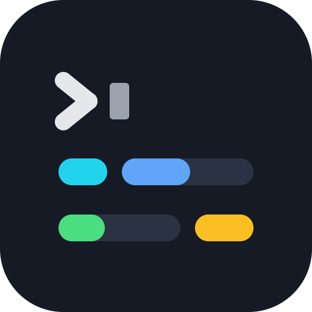

# session-line



A Claude Code mod that draws the status line itself. A `statusLine` command starts a process on every refresh; this mod starts none, and adds a prompt-cache meter.

```
Opus 5.5 · xhigh │ ▓▓░░░░░░░░ 21.0% │ ⎇ main (+12,-3) │ 1hr 5m
5h ▓░░░░░░░░░ 3.0% (2h33m) │ wk ▓▓░░░░░░░░ 19.0% (5d33m) │ cache 92% · 41m
```

The first row has the model and effort, the context fill, the git branch with uncommitted insertions and deletions, and the session length. The second has the 5-hour and weekly limits with the time to their reset, and the prompt cache: the share of the last prompt served from it and the time left before it lapses. In a narrow terminal each row wraps instead of being cut off.

## Install

At the prompt of a Claude Code terminal session:

```
/plugin install session-line --marketplace sfrangulov/claude-session-line
```

From a shell:

```
claude plugin install session-line --marketplace sfrangulov/claude-session-line
```

In the desktop app, where `/plugin` does not run: click + next to the prompt box, then Plugins, Add marketplace with `sfrangulov/claude-session-line`, then Add plugin.

Claude Code first asks to add the marketplace (`y`), then for a scope. If you have a `statusLine` command in `settings.json`, remove it, or the old line shows as well.

## Where the figures come from

| Figure | Source | Process |
| --- | --- | --- |
| model | `$.session.model()` | none |
| effort | the main loop's last request; before the first one, the level this model ran at last time, or the `effortLevel` setting | none |
| context, 5h, wk | `$.session.usage()` at the start, then `session.measure` | none |
| session length | `usage().startedAt` | none |
| branch | `.git/HEAD`, read as a file (a worktree's `.git` file is followed) | none |
| `(+ins,-del)` | `git diff HEAD --shortstat` at the start and after each turn | one per turn; none with `gitChanges: false` |
| cache | the token counts of each main-loop request | none |

A one-second timer redraws, and only when a text changed. Model, effort and HEAD are read again once a minute and after each prompt and turn.

## What it reads, runs and stores

- **Sends:** nothing, anywhere. The mod makes no network requests and no model requests, and passes nothing it reads to another program or service. What it reads is only drawn in the line.
- **Starts:** one program, `git`, with fixed arguments: `git --no-optional-locks diff HEAD --shortstat`, run in the session's work tree at the start and after each turn. It counts the uncommitted insertions and deletions shown as `(+ins,-del)`. Its output is read and drawn, nothing more. With `gitChanges: false` the mod starts no program at all.
- **Reads:**
  - `.git/HEAD` of the work tree above the session's folder, and a worktree's `.git` file, for the branch name.
  - `promptCacheTtl`, `idleCompaction` and `autoCompactEnabled` from the project's `.claude/settings.local.json` and `.claude/settings.json` and from the user's `.claude/settings.json`, plus the `effortLevel` setting.
  - Two keys of Claude Code's global config file (`.claude.json` in the home folder, or in `CLAUDE_CONFIG_DIR`): `autoCompactEnabled` and the cached flag saying whether idle compaction is rolled out to the account. Nothing else in that file is kept.
  - The environment variables listed under Cache meter, `CLAUDE_CODE_IDLE_COMPACT_MIN_TOKENS`, `DISABLE_PROMPT_CACHING*`, `DISABLE_COMPACT`, `DISABLE_AUTO_COMPACT`, `CLAUDE_CONFIG_DIR` and `HOME`.
- **Stores:** the effort each model last ran at (`{"Opus 5.5": "xhigh"}`), in the mod's own store on this machine, so the line can show it before a session's first request.

### Hooks

Apart from drawing its own rows and answering its own `/cache` command, every hook only observes: it passes the event on unchanged and blocks or rewrites nothing.

| Hook | What it does |
| --- | --- |
| `session.start`, `session.end` | registers `/cache`, reads the settings above, starts and stops the one-second timer; `/clear` resets the meter |
| `session.measure` | takes the context fill and the limit windows |
| `turn.step` | takes each main-loop request's effort and its four token counts; the request goes on as it was |
| `turn.complete` | marks model, effort and git for a refresh after a turn |
| `prompt.submit` | marks the line for a refresh after a prompt (a `/model`, `/effort` or `!` command may change it); the prompt goes on as typed |
| `session.compact` | notes a compaction, so the meter stops counting down the old cache |
| `command.run` (`/cache`), `ui.close`, `ui.press` | open and close the `/cache` pane |
| `ui.render` on `PromptHint`, `AbovePrompt`, `Pane` | draws the two rows, the band and the pane |

## Cache meter

- **In the line:** `cache 92% · 41m`, with seconds inside the warning (`0:45`), then `expired`. `miss` marks a request that wrote the cache where it should have read it. `⇣ 35m` counts down while Claude Code is set to compact the idle conversation by itself.
- **Band above the prompt** (`band`): with `action`, the default, it shows one line only when the cache needs you. That is when the cache is about to lapse on a prompt of 20k tokens or more, or has lapsed on one of `compactAtTokens` or more. `always` shows the full meter row; `off` shows nothing.
- **Toasts** come at the warning threshold, then at 10, 3, 2 and 1 seconds.
- **`/cache`** opens a pane with the countdown, the read, written and new tokens of the last request, and one row per turn. `/cache stop` closes it.

The cache lifetime follows Claude Code's rules. `FORCE_PROMPT_CACHING_5M`, `CLAUDE_CODE_PROMPT_CACHE_TTL`, the `promptCacheTtl` setting and `ENABLE_PROMPT_CACHING_1H` apply in that order. Otherwise it is 1 hour on a Claude subscription and 5 minutes elsewhere. It is also corrected from the timing between requests.

The meter only watches the cache. It never sends a request to keep the cache warm.

## Options

Set them in the `/config` menu, or under `pluginConfigs["session-line@claude-session-line"].options` in `~/.claude/settings.json`:

| Option | Default | |
| --- | --- | --- |
| `place` | `hint` | `hint`: two rows under the prompt; `status`: one plain status entry, which Claude Code labels `⚠ session-line:` |
| `ttl` | `auto` | `auto`, `5m` or `1h` |
| `warnSeconds` | `60` | when the countdown turns to seconds, the band asks for a message and toasts start |
| `compactAtTokens` | `100000` | prompt size at which a lapsed cache is worth a `/compact` |
| `band` | `action` | `action`, `always` or `off` |
| `toast` | `true` | toasts near expiry |
| `idleCompact` | `true` | idle-compaction countdown and notice |
| `gitChanges` | `true` | `(+ins,-del)` from one `git diff` per turn |

## Reading the line off the screen

A tool that scrapes the terminal for these figures can take the first `▓░` bar for the context and the bars labelled `5h` and `wk` for the limits. Those bars and labels stay. The band and the pane draw no bar glyph (`▓░█▒▌▏`) of their own.

## Development

```
claude plugin validate .
claude plugin test .
claude --plugin-dir .
```

`tsc -p .` type-checks once Claude Code has loaded the mod from this folder, since that is when it writes the API types to `.claude-plugin/types/`.

## Credits

The cache meter comes from [prompt-cache-control](https://github.com/davila7/claude-code-templates) 0.1.0 by Daniel (San) Ávila, under the MIT licence. `hooks/cache.ts` and `tests/cache.test.ts` are taken from it, and its hooks are merged into `hooks/register.tsx`. Both licences are in [LICENSE](LICENSE).
